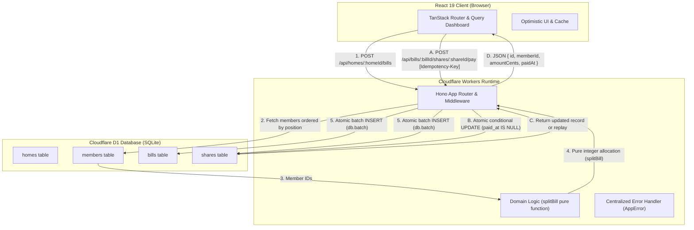
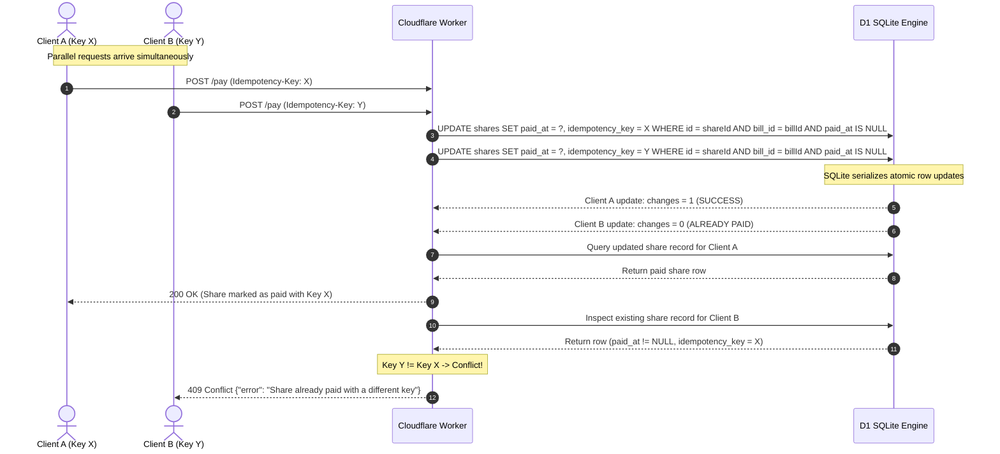

# System Architecture & Technical Specifications

This document details the architectural design, concurrency semantics, data models, and database constraints of the **Shared Bill Splitter** platform built on Cloudflare Workers, Cloudflare D1 (SQLite), and React + Vite.

---

## 1. System Topology & Data Flow



---

## 2. Database Schema & Named Constraints

The database schema (`api/migrations/0001_init.sql`) defines relational tables with strict integrity invariants. There are **11 named constraints** protecting data consistency:

| Constraint Name                       | Table     | Type          | Failure Mode Prevented                                                                                              | API & Application Handling                                                                                                                                           |
| :------------------------------------ | :-------- | :------------ | :------------------------------------------------------------------------------------------------------------------ | :------------------------------------------------------------------------------------------------------------------------------------------------------------------- |
| `ck_homes_name_non_empty`             | `homes`   | `CHECK`       | Blank, empty, or whitespace-only home names.                                                                        | Handled by string validation and trimming (`400 Bad Request`). Direct SQL invalid inserts fail.                                                                      |
| `fk_members_home`                     | `members` | `FOREIGN KEY` | Orphaned member records belonging to deleted or non-existent households (`ON DELETE CASCADE`).                      | API validates home existence before member creation (`404 Not Found`). D1 enforces relational consistency.                                                           |
| `uq_members_home_position`            | `members` | `UNIQUE`      | Duplicate join sequence positions within a home, which would produce non-deterministic remainder cent distribution. | The API assigns positions monotonically via `(SELECT COALESCE(MAX(position), 0) + 1 FROM members WHERE home_id = ?)`. The constraint guarantees serialized ordering. |
| `ck_members_name_non_empty`           | `members` | `CHECK`       | Blank, whitespace-only, or empty member names.                                                                      | The API trims names and verifies `length > 0` (`400 Bad Request`). SQLite schema rejects any illegal direct database inserts.                                        |
| `fk_bills_home`                       | `bills`   | `FOREIGN KEY` | Bills created for invalid or deleted households (`ON DELETE CASCADE`).                                              | The API checks home existence returning `404 Not Found`. Foreign key cascades clean up bills upon home deletion.                                                     |
| `ck_bills_total_cents_positive`       | `bills`   | `CHECK`       | Negative, zero, or invalid bill totals.                                                                             | The API validates `typeof totalCents === 'number' && Number.isSafeInteger(totalCents) && totalCents > 0` (`422 Unprocessable Entity`).                               |
| `ck_bills_title_non_empty`            | `bills`   | `CHECK`       | Empty or whitespace-only bill titles.                                                                               | The API enforces `title.trim().length > 0` (`400 Bad Request`).                                                                                                      |
| `fk_shares_bill`                      | `shares`  | `FOREIGN KEY` | Orphaned shares belonging to deleted bills (`ON DELETE CASCADE`).                                                   | D1 cascades deletion when a bill is deleted.                                                                                                                         |
| `fk_shares_member`                    | `shares`  | `FOREIGN KEY` | Shares referencing non-existent members.                                                                            | The API queries members directly from the target household before generating shares.                                                                                 |
| `ck_shares_amount_cents_non_negative` | `shares`  | `CHECK`       | Negative share amounts, while safely permitting 0-cent shares when total cents is less than member count.           | Handled by `splitBill` pure arithmetic and SQLite CHECK constraint.                                                                                                  |
| `ck_shares_paid_idempotency`          | `shares`  | `CHECK`       | Inconsistent payment states (e.g., `paid_at` set without `idempotency_key`, or key set without `paid_at`).          | Enforces that unpaid shares have null for both fields, and paid shares have non-null for both fields.                                                                |
| `uq_shares_bill_member`               | `shares`  | `UNIQUE`      | Duplicate share allocations for the same member on a single bill.                                                   | Enforces exactly one share per member per bill.                                                                                                                      |

---

## 3. Concurrency Model: Payment Lifecycle & Race Resolution

The payment lifecycle (`POST /api/bills/:billId/shares/:shareId/pay`) handles repeated requests, network retries, and concurrent parallel double-payment attempts without distributed locks:



### Step-by-Step Race Resolution:

1. **Idempotency-Key Requirement**: Every payment request must provide an `Idempotency-Key` header. Missing keys immediately return `400 Bad Request`.
2. **Atomic State Transition**: The mutation executes:

   ```sql
   UPDATE shares
   SET paid_at = ?, idempotency_key = ?
   WHERE id = ? AND bill_id = ? AND paid_at IS NULL
   ```
3. **Winner Execution (`changes === 1`)**:
   - Exactly one concurrent query will find `paid_at IS NULL` and mutate the row.
   - The worker queries the newly modified share row and returns `200 OK`.
4. **Loser Execution (`changes === 0`)**:
   - Any concurrent or subsequent query finds `paid_at IS NOT NULL` (or invalid IDs).
   - The worker performs a read of the share:
     - If the bill does not exist: returns `404 Not Found`.
     - If the share does not exist or does not belong to the bill: returns `404 Not Found`.
     - If the share was already paid with the **same** `idempotency_key`: returns `200 OK` with the exact original payment timestamp and details (idempotent replay).
     - If the share was already paid with a **different** `idempotency_key`: returns `409 Conflict` (`Share already paid with a different key`).

---

## 4. Bill Splitting Algorithm & Invariants

The bill splitting algorithm is isolated in `api/src/domain/splitter.ts` as a pure, deterministic function:

$$\text{base} = \lfloor \frac{\text{totalCents}}{N} \rfloor$$
$$\text{remainder} = \text{totalCents} \pmod N$$

- The first $\text{remainder}$ members in monotonic join sequence receive $\text{base} + 1$ cents.
- The remaining $N - \text{remainder}$ members receive $\text{base}$ cents.
- **Invariants**:
  1. $\sum_{i=1}^N \text{shares}[i] = \text{totalCents}$
  2. $\max(\text{shares}) - \min(\text{shares}) \le 1$
  3. All amounts are strictly positive safe integers.
  4. Execution is side-effect-free with $O(N)$ computational complexity.

---

## 5. Frontend Architecture & Resiliency

The web interface is built using **React 19**, **Vite**, **TanStack Router**, and **TanStack Query**:
- **Type-Safe Routing**: Routes (`/` and `/$homeId`) use TanStack Router's parameter validation and code splitting.
- **Automatic Polling & Invalidation**: TanStack Query manages server state caching, background invalidation on mutations (adding members, creating bills, paying shares), and auto-refresh intervals.
- **Network Resiliency**:
  - The API client enforces a 10-second `AbortController` timeout on all network requests.
  - Skeletons prevent layout shifts during data loading (`DashboardSkeleton`).
  - Error boundaries wrap both the root layout and individual components with user-facing recovery actions.
  - Payment buttons maintain a single UUID idempotency key across failed attempts until a successful `200 OK` response is received, avoiding accidental double-charge keys during network retries.
